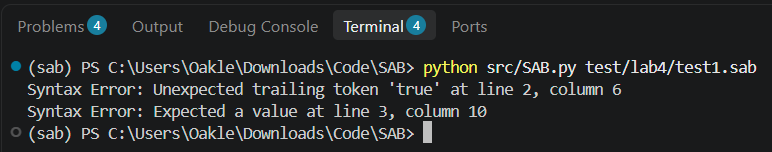
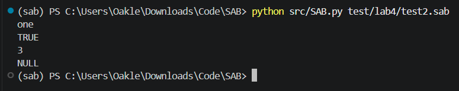

# Lab 4: Statements
**Language Name:** SAB (Subtract And Branch)

## By Drake Setera ##

## Overview and Design Choices

For Lab 4, I extended the SAB interpreter from the midterm to handle `print` and expression statements. Additionally, I added panic-mode error recovery.

Instead of making a separate thing to evaluate values in a print statement, I reuse the evaluate for expressions and then just print the result. Since I want my language to be a compiled language instead of just an interpreted language, I have an interpreter mode which will print when it is true. This is because when I compile a file at the en of this project instead of `print` showing something on screen it will compile to my own custom assembly that will `print` when executed.

For backend evaluation in `Expression_Interpreter`, I make `TRUE` and `FALSE` into python booleans and `NULL` into a python `None` so type conversions and math/logic operations in `operations.py` stay clean. Then when `print_statement()` outputs the result in `interpret_mode`, it converts the values back into SAB's syntax.

## Panic-Mode Error Recovery

To prevent the interpreter from crashing on the first syntax error, I implemented panic-mode error recovery inside `Interpreter.parse()`.

`Interpreter.parse()` catches errors, prints the error message, and calls `self.panic_mode()`. The `panic_mode()` method keeps moving tokens until it either:
* Passes a `TokenType.SEMICOLON` or
* Peeks at the next statement token in `STATEMENT_TOKEN`.

## Setup and Run Instructions


**To run Interpreter Mode:**
```bash
python src/SAB.py
```

**To run Compile Mode with tests for this lab:**
```bash
python src/SAB.py test/lab4/test1.sab
python src/SAB.py test/lab4/test2.sab
```

## Test Cases and Output

### Test Case 1

**Source Input (`test/lab4/test1.sab`):**
```text
"one"
true;
print 2 +
```

**Expected Output:**
```text
Syntax Error: Unexpected trailing token 'TRUE' at line 2, column 1
Syntax Error: Expected a value at line 3, column 11
6
```

**Actual Program Output:**


---

### Test Case 2

**Source Input (`test/lab4/test2.sab`):**
```text
4 + 2;
print "one";
print TRUE;
print 1 + 2;
print NULL;
```

**Expected Output:**
```text
one
TRUE
3
NULL
```

**Actual Program Output:**


## Known Limitations

Currently, evaluating expressions doesn't get saved anywhere because variables don't exist yet. Also, when errors are raised on booleans and NULL's it prints out the python backend variables not the `SAB` ones. Additionally, sometimes the column number might be off by a little bit when errors are raised, but lines are correct. 