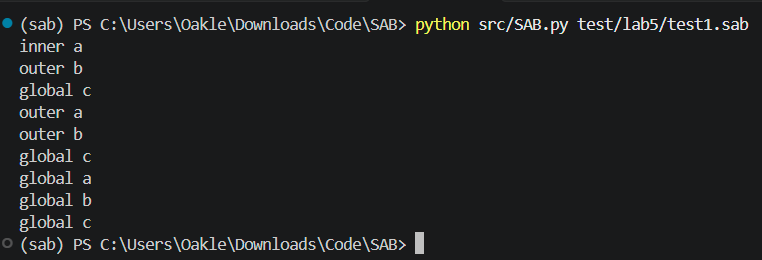
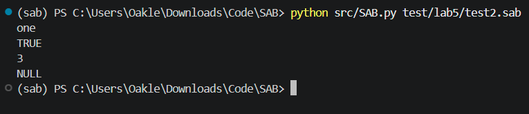
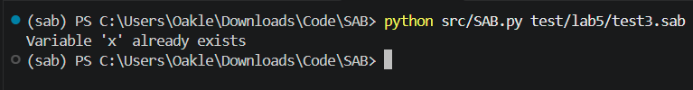
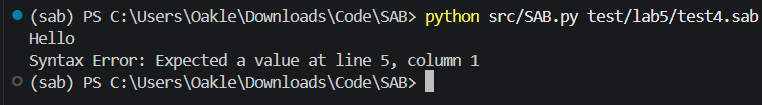
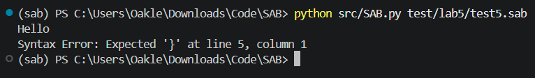
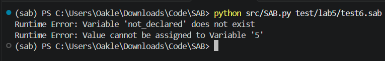

# Lab 5: Variables
**Language Name:** SAB (Subtract And Branch)

## By Drake Setera ##

## Overview and Design Choices

For Lab 5, I extended the SAB interpreter to support variable declarations, variable access, assignment, and block scoping. To manage environments, I created a `Variable` class and a `Variable_Stack` class in `src/variable.py`. The `Variable_Stack` uses a Python list of dictionaries (`self.stack = [{}]`), where index `0` is the global scope and each nested block appends a new dictionary on top of the stack.

In addition to `var`, SAB also supports explicit type keywords (`int`, `char`, `str`, `float`, `hex`, `bin`) for variable declarations, since I eventually want to add static type checking when compiling to SAB assembly. Currently any variable type can be used the same way as `var` to create a variable.

Here are the design choices I made for variables:

* **Variable access before declaration:** Trying to read or use a variable that haven't been declared yet is a runtime error. `Variable_Stack.find_ptr()` searches backwards from the innermost scope down to the global scope. If the variable isn't found anywhere in the stack, it raises a `ValueError`, which `Interpreter` catches and prints as a `Runtime Error`.
* **Missing initializer in the declaration:** If a variable is declared without an `=` initializer (for example, `var x;`), it is still valid and defaults to `None` in the backend. When it gets printed in `interpret_mode`, it outputs `NULL` to match SAB's syntax.
* **Redeclaration:** Redeclaring a variable with the same name in the same scope is not allowed. `Variable_Stack.declare()` checks if the identifier already exists in `self.stack[-1]` and raises an error. However, declaring a variable with the same name inside a nested block is allowed and shadows the outer variable until that block ends.

## Block Scope

To support block statements, I added `TokenType.LEFT_BRACE` to `STATEMENT_TOKEN` and implemented `block_statement()` in `src/interpreter.py`.

When the interpreter sees a `{`, it calls `self.variables.enter_block()` to append a new empty dictionary onto the variable stack. It then executes statements in a loop until it hits a `}` or `EOF`. I wrapped the block execution in a try and finally block so `self.variables.exit_block()` always runs and pops the local scope, even if an error happens inside the block. I also updated `panic_mode()` to stop at `}` so a syntax error inside a block doesn't pass the closing brace.

In `SAB.py`, I also updated interactive mode (REPL) to create one `Variable_Stack` and pass it into `Interpreter` on each line so variables stay alive across REPL commands.

## Error Handling

In addition to the panic-mode error recovery from Lab 4, the interpreter now detects and reports errors related to variables and blocks without crashing:

* **Unclosed braces:** If `block_statement()` reaches `EOF` without matching a `}`, it raises a `SyntaxError` reporting `Expected '}'` with the line and column number.
* **Unopened braces:** An extra `}` outside of a block gets passed to `Expression_Parser`, which reports a `SyntaxError` (`Expected a value`) at that line and column.
* **Redeclaration in the same scope:** Raises an error (`Variable '{name}' already exists`).
* **Accessing an undeclared variable:** Caught and printed as `Runtime Error: Variable '{name}' does not exist`.
* **Invalid assignment targets:** Attempting to assign to a non-variable target (like `5 = 10;` or `1 + 2 = 3;`) is rejected instead of allowing an invalid l-value assignment.

## Setup and Run Instructions

**To run Interactive Mode (REPL):**
```bash
python src/SAB.py
```

**To run Source-File Mode with the Lab 5 tests:**
```bash
python src/SAB.py test/lab5/test1.sab
python src/SAB.py test/lab5/test2.sab
python src/SAB.py test/lab5/test3.sab
python src/SAB.py test/lab5/test4.sab
python src/SAB.py test/lab5/test5.sab
python src/SAB.py test/lab5/test6.sab
```

## Test Cases and Output

### Test Case 1: Block Scope and Shadowing (Textbook Example)

**Source Input (`test/lab5/test1.sab`):**
```text
var a = "global a";
var b = "global b";
var c = "global c";
{
    var a = "outer a";
    var b = "outer b";
    {
        var a = "inner a";
        print a;
        print b;
        print c;
    }
    print a;
    print b;
    print c;
}
print a;
print b;
print c;
```

**Expected Output:**
```text
inner a
outer b
global c
outer a
outer b
global c
global a
global b
global c
```

**Actual Program Output:**


---

### Test Case 2: Variable Declaration, Access, Assignment, and Missing Initializer

**Source Input (`test/lab5/test2.sab`):**
```text
var x;
print x;
var y = 10;
print y;
y = y + 5;
print y;
```

**Expected Output:**
```text
NULL
10
15
```

**Actual Program Output:**


---

### Test Case 3: Redeclaring a Variable in the Same Scope

**Source Input (`test/lab5/test3.sab`):**
```text
# redeclaring variable
var x = 21;
var x = 56;
print x;
```

**Expected Output:**
```text
Variable 'x' already exists
```

**Actual Program Output:**


---

### Test Case 4: Unopened Brace

**Source Input (`test/lab5/test4.sab`):**
```text
# Unopened bracket
var x = "Hello";

    print x;
}
```

**Expected Output:**
```text
Hello
Syntax Error: Expected a value at line 5, column 1
```

**Actual Program Output:**


---

### Test Case 5: Unclosed Brace

**Source Input (`test/lab5/test5.sab`):**
```text
# Unclosed bracket
var x = "Hello";
{
    print x;
```

**Expected Output:**
```text
Hello
Syntax Error: Expected '}' at line 5, column 1
```

**Actual Program Output:**


---

### Test Case 6: Access Before Declaration & Invalid Assignment Target

**Source Input (`test/lab5/test6.sab`):**
```text
print not_declared;
5 = 10;
```

**Expected Output:**
```text
Runtime Error: Variable 'not_declared' does not exist
Syntax Error: Invalid assignment target at line 2, column 3
```

**Actual Program Output:**


## Known Limitations

Typed variable declarations (`int`, `str`, `float`, etc.) currently store their type token in the `Variable` object, but strict static type checking on reassignment hasn't been enforced yet. Also, column numbers on some errors can occasionally be off by a character, though the line numbers are accurate.